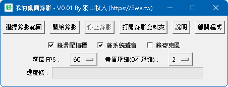
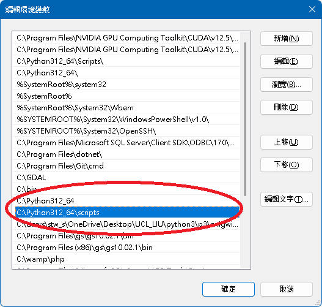

# my_cam_py
我的桌面錄影

用 python 寫的桌面錄影工具

<h3>開發動機:</h3> 
覺得人生是該寫一個桌面錄影，就開始寫了

<h3>版本：</h3>
V0.02 
穩定化分支：已補強錄影流程、音源選擇、安全輸出、錯誤 log、設定記憶與長時間錄影觀測

<h3>作者：</h3>
 羽山秋人 (https://3wa.tw)

<h3>版權：</h3>
 MIT

<h3>最初開發日期：</h3>
 2024-07-12
 
<h3>使用方法：</h3>
<ul>
	<li>1. 框選螢幕想錄的範圍，正向或反向拖曳都可以</li>
	<li>2. 設定好 fps，通常大概只會選 30 或 60 吧</li>
	<li>3. 壓縮品質，與 png 壓縮品質有關，0 最清晰，建議設 1 或 2</li>
	<li>4. 要錄滑鼠指標嗎 可勾選</li>
	<li>5. 「錄滑鼠指標」、「錄系統聲音」與「錄麥克風」集中在同一排，可直接切換</li>
	<li>6. 建議先按「自動測試」，程式會依目前電腦可用音源自動選擇系統聲與麥克風，失敗的聲道會自動關閉</li>
	<li>7. 需要手動指定時，按「音源選擇」往下展開，系統音源與麥克風會分成兩行顯示；再按一次可隱藏並縮回小視窗</li>
	<li>8. 按下開始錄影即開始</li>
	<li>9. 按下停止錄影後，程式會在背景完成收尾與影片、聲音合併轉檔</li>
	<li>10. 完成後會提示「錄影完成」，並用檔案總管開啟到該 mp4 檔案</li>
</ul>
<h3>系統聲音注意事項：</h3>
<ul>
	<li>Windows 電腦若沒有「立體聲混音 / Stereo Mix」或其他可錄系統音的輸入裝置，可能無法直接錄系統聲音。</li>
	<li>找不到系統音源時，程式不會再自動改錄 device 0，會略過系統聲音，避免錄錯音源或錄到一半 crash。</li>
	<li>若需要錄系統聲音，可先到 Windows 音效設定啟用 Stereo Mix，或使用虛擬 loopback 音源。</li>
	<li>麥克風與系統音源建議錄影前先按「自動測試」；若偵測結果不符合需求，再展開「音源選擇」手動指定。</li>
	<li>程式會記住上次選擇的音源名稱，下次啟動時會盡量依名稱回選；若 USB 裝置重插造成 index 改變，也會優先找同名裝置。</li>
	<li>開始錄影前會先檢查已選音源是否可開啟，失敗時會略過該聲道並寫入 log。</li>
</ul>

 
程式執行畫面

<h3>相依套件：</h3>
	python3.12 x64 位元，建議可安裝在 C:\python312_64 
	將系統路徑 
		PATH 加上 C:\python312_64 
		PATH 加上 C:\python312_64\Scripts 
	 
		
	opencv-python==4.10.0.84
	sounddevice==0.4.7
	soundfile==0.12.1
	scipy==1.14.0
	moviepy==1.0.3
	pydub==0.25.1
	pywin32==306
	pywin32-ctypes==0.2.2
	pyinstaller==6.9.0
	mss (此版羽山有微調 base.py 與 windows.py)
	
	詳見 requirements.txt
	
<h3>安裝相關套件：</h3>
	C:\python312_64\Scripts\pip.exe install -r requirements.txt

<h3>啟動：</h3>
	run.bat

<h3>設定與紀錄：</h3>
<ul>
	<li>config.json：保存 fps、壓縮品質、是否錄滑鼠、是否錄系統音、是否錄麥克風與上次音源名稱。</li>
	<li>output/logs/YYYYMMDD.log：記錄音源檢查、錄音失敗、畫面擷取錯誤與轉檔狀態。</li>
	<li>錄影時 FPS 顯示會附帶 frame queue 與 dropped frame 統計，長時間錄影可用來判斷是否有掉幀。</li>
	<li>背景 thread 發生未預期例外時會寫入 log，並嘗試自動進入收尾流程，避免 UI 卡住。</li>
	<li>轉檔會先輸出到 *_tmp_final.mp4，成功後才替換正式 mp4，避免半成品覆蓋輸出檔。</li>
	<li>停止錄影後會分段顯示收尾、合併聲音、快速封裝、慢速 fallback 與完成狀態。</li>
</ul>

<h3>穩定性改善：</h3>
<ul>
	<li>錄影範圍會先正規化，支援反向框選。</li>
	<li>畫面 frame 改用 bounded queue，長時間錄影時會丟棄過舊 frame，避免記憶體持續膨脹。</li>
	<li>停止錄影改成背景收尾，不在 UI thread 直接等待錄影、錄音與轉檔工作。</li>
	<li>音源開啟失敗時會略過該聲道並保留影片輸出。</li>
	<li>worker thread 例外會集中寫 log，並嘗試自動停止與收尾。</li>
	<li>錄影 frame timestamp 使用 monotonic clock，避免 Windows 校時造成影片時長暴增。</li>
	<li>系統音源會優先選「立體聲混音 / Stereo Mix / loopback」，避免泛用輸入裝置壓過真正的系統聲音來源。</li>
	<li>若連續畫面擷取失敗達約 3 秒，程式會主動停止錄影並寫 log，避免留下無效 mp4。</li>
	<li>若遇到 Windows GDI 的 GetDIBits / BitBlt 擷取錯誤，會立即停止錄影並收尾，避免 mss 持續重試造成 native crash。</li>
	<li>滑鼠游標不再走 mss 的 GDI cursor capture，改用 OpenCV 軟體 overlay，降低錄影中 access violation 風險。</li>
	<li>開始錄影前會先做一次畫面擷取測試，失敗時不啟動錄音與錄影 thread。</li>
	<li>影片與聲音合成優先使用 ffmpeg copy video 快速封裝，避免 MoviePy 重新逐 frame 編碼；失敗時才改用 MoviePy 慢速輸出。</li>
	<li>若發生未捕捉例外或 native fatal crash，會寫入 output/logs/crash_*.log。</li>
</ul>

<h3>開發驗證：</h3>
<pre>
python -m unittest tests.test_recorder_core -v
python -m py_compile my_cam_py.py recorder_core.py portalocker.py
python -c "import cv2, sounddevice, soundfile, moviepy, pydub, mss; print('imports ok')"
</pre>

<h3>實錄檢查：</h3>
	詳見 docs/smoke-test-checklist.md
	
<h3>編譯成exe：</h3>
	可詳見 build.bat
	如果不想執行時有視窗，可以加上 -w 參數
	 GitHub 單檔限制 100MB，dist/my_cam_py.exe 不再直接放進 git；正式發佈建議使用 GitHub Releases 或本機執行 build.bat 產生。
	
<h3>成果範例：</h3>
	https://github.com/shadowjohn/my_cam_py/tree/main/examples

<h3>更新歷程：</h3>
(2026-05-27) main 穩定版： 
v0.02 穩定化分支已合併回 main，包含停止後分段進度、ffmpeg 快速合成、完成後選取輸出檔、crash log、音源選擇與錄影穩定性修正。 

(2026-05-26) v0.02 穩定化版： 
修正反向框選、frame queue、背景 thread 更新 UI、停止錄影非阻塞、音源選擇 UI、錄音失敗保護與暫存輸出忽略規則。 
新增安全輸出機制，轉檔先寫入 *_tmp_final.mp4，成功後才替換正式檔；新增 output/logs/YYYYMMDD.log 錯誤紀錄與實錄 smoke test checklist。 
新增 config.json 設定記憶、音源名稱回選、開始錄影前音源檢查與依裝置支援調整錄音 channels。 
新增 worker thread 例外保護、frame queue dropped 統計與 FPS 顯示整合。 
錄製選項集中成同一排，新增「自動測試」與可收合的「音源選擇」，展開時系統音源與麥克風分成兩行，降低不同電腦選錯音源的機率。 
修正 frame timestamp 受系統時鐘跳動影響造成影片時長暴增，並修正系統音源選擇會誤用泛用輸入裝置的問題。 
新增 crash_*.log、thread traceback、Tk callback exception 紀錄與連續擷取失敗自動停止保護。 
修正 mss Windows GDI 擷取 access violation 風險：錄影前先 preflight，GetDIBits / BitBlt 錯誤立即停止，滑鼠游標改由軟體 overlay。 
停止錄影後新增分段進度提示；完成後提示並用檔案總管選取輸出 mp4；合成優先使用 ffmpeg copy video 快速封裝，失敗才回 MoviePy 慢速輸出。 

(2024-07-14) v0.01 版： 
初版 
https://www.microsoft.com/en-us/wdsi/submission/3ed2b02f-bdb6-43b3-86ce-86acf056181e
		
<h3>Todo：</h3>
<ul>
	<li>依 docs/smoke-test-checklist.md 實測長時間錄影與不同電腦音源組合</li>
	<li>研究 WASAPI loopback 或虛擬音源支援，改善沒有 Stereo Mix 的電腦錄系統聲音問題</li>
	<li>實錄壓測後，再評估是否拆分 ui_app.py / recording_worker.py</li>
</ul>

